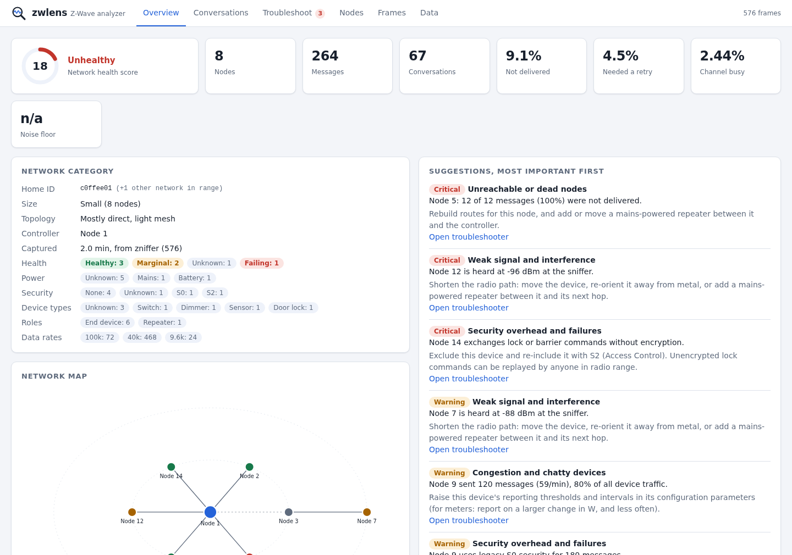

# zwlens


**Capture and troubleshoot a Z-Wave network from one small app.** Plug in a Zniffer stick, press
**Capture**, and zwlens shows you the traffic live, tells you what is wrong, and what to fix first.

- **It does the capturing itself.** zwlens talks to the Zniffer stick directly: no Z-Wave JS UI,
  Silicon Labs Zniffer or other capture software is needed. It also reads saved captures and logs.
- **It explains what it sees.** Traffic becomes readable conversations; every node is categorised;
  five troubleshooters and a library of 85 known failure modes produce a prioritised to-do list.
- **It tells you how to fix it on your hub.** Step-by-step menu paths for Home Assistant, Hubitat,
  SmartThings, Qolsys IQ Panel, 2GIG, Alarm.com / SuretyDIY and Ring.
- **Nothing to install but Python.** No packages, no build step, no account. It runs on Linux, macOS
  and Windows, entirely on your computer; captures never leave it.



<sub>The Overview tab, showing the bundled sample capture.</sub>

## Quick start

1. Install [Python 3.9 or newer](https://www.python.org/downloads/) if you do not have it.
2. Download zwlens: `git clone https://github.com/bionicrocky/zwlens.git`, or use
   *Code > Download ZIP* on GitHub and unpack it.
3. Start it by double-clicking the launcher for your system:

   | System | Launcher |
   |---|---|
   | Windows | `start-zwlens.bat` |
   | macOS | `start-zwlens.command` |
   | Linux | `start-zwlens.sh` (or run `python3 -m zwlens` in the folder) |

If macOS refuses to open the launcher because it is from an unidentified developer, right-click it
and choose *Open*. Your browser opens at <http://localhost:8377>. From there **everything is done in the app**:

| You want to | In the app |
|---|---|
| Capture live from a Zniffer stick | **Data** > *Live from a Zniffer stick* > pick the port > **Capture** |
| Change the stick's radio region | The *Radio region* list that appears once capturing |
| Free a stick another program is using | zwlens names the program and offers **Stop it and capture** |
| Open a saved capture or log | Drop the file anywhere on the page |
| Follow a Z-Wave JS / Home Assistant controller | **Data** > *Live from a controller* > **Connect** |
| Try it with no hardware | **Try with sample data** |
| Keep a live capture | **Data** > **Save as .zlf** |
| Get a report | **Data** > **Export report** or **Export JSON** |
| Name your devices | **Nodes** > **Rename** |

No Zniffer stick yet? See [Zniffer hardware](#zniffer-hardware) for what to buy and how to switch
a stick into Zniffer mode.

Two things the app cannot do for you, once per computer:

- **Linux:** allow your user to open serial ports with `sudo usermod -aG dialout $USER`, then log
  out and back in.
- **Windows:** live capture needs one extra package: `py -m pip install pyserial`.

<details>
<summary>Command-line options, for scripts and servers</summary>

```
python3 -m zwlens serve capture.zlf zwavejs.log     # load files at startup
python3 -m zwlens serve --zniffer /dev/ttyACM0      # start capturing immediately
python3 -m zwlens serve --live ws://localhost:3000  # follow a Z-Wave JS server (read-only)
python3 -m zwlens serve --no-browser --port 9000    # headless
python3 -m zwlens ports                             # list serial ports
python3 -m zwlens analyze capture.zlf               # print a report and exit (--format json)
```

`pip install .` is optional and adds a `zwlens` command.

</details>

## What you get

| Tab | What it shows |
|---|---|
| **Overview** | Health score, network category (size, topology, power, security, device types), a network map, and suggestions ordered by importance. |
| **Conversations** | Traffic grouped into exchanges between two nodes, shown message by message with ACKs, retransmissions, wake-up beams, routes, signal and timing. |
| **Troubleshoot** | Five guided troubleshooters (unreachable nodes, weak signal and interference, routing, congestion, security), each with findings and a checklist, followed by the known-issue library. |
| **Nodes** | Every node categorised by type, role, power source, security, health and traffic. *Rename* gives a node an alias, location and notes. |
| **Frames** | Every decoded frame, searchable, with raw bytes. |
| **Data** | Load files, start a live capture, save a capture as `.zlf`, export a report. |

### Known-issue library

The Troubleshoot tab includes a searchable library of 85 Z-Wave failure modes: what goes wrong,
likely causes, what to do, and links to the sources. Each entry is marked *Detected*, *Not seen*,
or *Check by hand* (problems that traffic cannot reveal, such as a stick in a metal rack).

- 30 entries are checked against decoded traffic (for example a device answering "busy", a node
  that was factory reset, wake-up notifications sent to the wrong controller, polling storms).
- 106 rules match messages in Z-Wave JS logs (for example a jammed or unresponsive controller,
  failed S2 bootstrapping, missing network keys, failed route rebuilds).

The library was compiled from the Z-Wave JS troubleshooting documentation and driver source,
Silicon Labs documentation, and Home Assistant, Hubitat, openHAB and vendor forums. It is not
exhaustive, and entries without a detector are reference material only.

### Controller guides

Pick your controller at the top of the Troubleshoot tab and each checklist shows how to carry out
its steps on that hub: adding and removing devices, removing dead nodes, rebuilding routes, seeing
routes and signal, getting logs, changing device settings, and firmware and backup. Guides cover:

- Home Assistant (Z-Wave JS / Z-Wave JS UI)
- Hubitat Elevation
- SmartThings / Aeotec Smart Home Hub
- Qolsys IQ Panel 2 / 2+ / 4 (Alarm.com)
- 2GIG GC2 / GC3 / Edge (Alarm.com)
- The Alarm.com website and app, and SuretyDIY
- Ring Alarm Base Station

Menu paths are quoted from the makers' documentation, with a source link on each item. Firmware
updates move menus, so check the linked page if something does not match. Where a maker documents
nothing (Ring and SmartThings expose very little), the guide says so.

### Aliases

Aliases are stored in `aliases.json` in your user configuration folder (`~/.config/zwlens` on Linux,
`~/Library/Application Support/zwlens` on macOS, `%APPDATA%\zwlens` on Windows) and are reused for
every capture of the same network. Use `--aliases PATH` to keep them elsewhere.

## Data sources

| Source | What to load | Notes |
|---|---|---|
| **Live Zniffer stick** | The stick's serial port (`/dev/ttyACM0`, `COM5`) | Sees everything on air. See [Zniffer hardware](#zniffer-hardware). |
| **Zniffer captures** | `.zlf` files from Z-Wave JS UI or the Silicon Labs Zniffer | Z-Wave JS UI saves them as `zniffer_capture_<date>.zlf` in its store folder. |
| **Z-Wave JS logs** | Driver log files from Z-Wave JS, Z-Wave JS UI or the Home Assistant add-on | Set the driver log level to `debug` so commands and transmit reports are logged. |
| **Live Z-Wave JS** | A Z-Wave JS server WebSocket (`ws://host:3000`) | Read-only: zwlens only subscribes to events and logs. Enable the WS server in Z-Wave JS UI under *Settings > Home Assistant*. |
| **SDR output** | Text with one frame per line as hex (timestamp and `rssi=` optional), or classic `.pcap` | Frames are located by checksum, so decoder-specific prefixes are tolerated. |

A sniffer and a controller log show different things. A sniffer sees every hop, ACK and
retransmission but cannot read encrypted payloads; a controller log shows decrypted commands and
the controller's own transmit reports but nothing between other nodes. Loading both for the same
period counts messages twice, so analyse them separately.

## Zniffer hardware

A Zniffer is a Z-Wave USB stick running Silicon Labs *Zniffer* firmware instead of controller
firmware. **A stick cannot be a controller and a Zniffer at the same time, so you need a second
stick: never convert the one that runs your network.**

| Stick | Status | Notes |
|---|---|---|
| **Home Assistant Connect ZWA-2** (800 series) | **Tested with zwlens** | Official web flasher switches between controller and Zniffer firmware. [Product page](https://www.home-assistant.io/connect/zwa-2/) · [Amazon](https://www.amazon.com/dp/B0FL858V4Q) |
| **Silicon Labs ZGM230-DK2603A** dev kit (800 series) | Should work, not tested here | The device Z-Wave JS recommends; flashed with Simplicity Studio. [Silicon Labs](https://www.silabs.com/development-tools/wireless/z-wave/z-wave-800-dev-kit) |
| Silicon Labs UZB3 (500 series) | Should work, not tested here | Firmware is hard to obtain, flashing is Windows-only and can brick the stick. White sticks are region-locked. Start zwlens with `--zniffer-chip 500`. |
| Silicon Labs UZB-7 (700 series) | Unverified | Z-Wave JS lists it as "may also work". |
| Zooz ZST39 LR, Zooz ZST10-700, Aeotec Z-Stick 7, Aeotec Z-Stick 10 Pro | **Not supported** | No Zniffer firmware is published for these. They work fine as controllers. |

<!-- If the Amazon link above is replaced with an Associates link, add this line next to it:
     "As an Amazon Associate I earn from qualifying purchases." -->

zwlens speaks the same serial protocol as Z-Wave JS's Zniffer support (115200 baud), so any stick
that works as a Zniffer in Z-Wave JS UI should work here.

### Putting a Home Assistant Connect ZWA-2 into Zniffer mode

> **This erases the stick.** Switching firmware wipes all network data from the ZWA-2. If it has
> ever been your controller, every device joined to it is orphaned and must be included again.
> Use a spare ZWA-2, or back up the network in Home Assistant first.

1. Plug the ZWA-2 into a computer and close anything using it (Z-Wave JS UI, Home Assistant).
2. In Chrome or Edge (the flasher needs Web Serial), open the
   [ZWA-2 toolbox](https://toolbox.openhomefoundation.org/home-assistant-connect-zwa-2/).
3. Under *Z-Wave firmware*, choose **Install Z-Wave Zniffer firmware** (marked Experimental).
4. Select the ZWA-2's serial port when the browser asks, tick the box confirming that network data
   will be erased, and let it flash.
5. Close the toolbox tab so it releases the port.

To turn it back into a controller, use **Install Z-Wave controller firmware** in the same toolbox.
The network data is not restored: restore a backup or start a new network.

### Other sticks

- **Silicon Labs dev kits:** in Simplicity Studio 5, erase the chip, install the *Z-Wave OTW
  Bootloader* for your board, then run the *Z-Wave - NCP Zniffer* demo. The full procedure is in
  the [Z-Wave JS Zniffer guide](https://github.com/zwave-js/zwave-js/blob/master/docs/troubleshooting/zniffer.md).
- **UZB3:** follow Silicon Labs'
  [conversion article](https://community.silabs.com/s/article/z-wave-500-converting-a-uzb3-controller-to-a-zniffer).

### Capturing

1. Plug the stick in and open the **Data** tab. zwlens lists the serial ports it finds; press
   *Rescan* if yours is missing.
2. Pick the port and press **Capture**. Frames appear in every tab as they arrive.
3. Check the *Radio region* shown once it connects, and change it there if it does not match your
   network.
4. Press **Stop** when you have enough, and **Save as .zlf** if you want to keep it.

Only one program can use the stick at a time. If Z-Wave JS UI has it open, zwlens names the
program holding the port and offers to stop it, and never sends anything to a busy port. To keep
Z-Wave JS UI running instead, let it capture and load the `.zlf` files it saves.


**Place the sniffer next to your controller.** Signal levels are measured at the sniffer, so that
is the only position where they say something about what the controller hears.

## How to read the results

- **Battery devices that sleep** only listen briefly after they wake up. Failed commands to them
  between wake-ups are expected.
- **Locks and other beam-woken (FLiRS) devices** normally fail once, get a wake-up beam, and then
  answer. zwlens recognises that pattern and does not count it as a failure.
- **A sniffer only knows what it hears.** An ACK it missed is reported as missing. If the sniffer
  hears even the controller weakly, zwlens says so and skips per-node weak-signal findings.
- **The health score** starts at 100 and loses points for each finding. Use it to compare captures
  of the same network before and after a change, not as an absolute grade.

## Limits

- Encrypted payloads (S0/S2) are not decrypted from sniffer or SDR captures. zwlens sees that a
  secure exchange happened, not what was said. Controller logs show the decrypted commands.
- Zniffer signal levels use a reverse-engineered conversion and are approximate.
- The 3-channel frame format used in Japan and Korea is not decoded. Long Range frames are decoded
  but untested against real Long Range traffic.
- `pcapng` is not read; convert with `editcap -F pcap`.
- Tested against a Home Assistant Connect ZWA-2 (US region) and Z-Wave JS UI captures. Other
  sticks, regions and SDR tools have not been tried; the bundled samples are synthetic.
- Stopping the program that holds a serial port works on Linux and macOS for your own processes.

## Development

```
python3 -m unittest discover -s tests
```

The code is plain Python in `zwlens/`:

| File | Purpose |
|---|---|
| `mpdu.py`, `cc.py` | Z-Wave frame and command class decoding |
| `parsers/` | Z-Wave JS logs, `.zlf` captures, SDR text and pcap |
| `zniffer_live.py`, `live.py` | Live capture from a Zniffer stick and from a Z-Wave JS server |
| `analysis.py` | Conversations, node categories, the five troubleshooters, suggestions |
| `knowledge.py`, `kb_entries.py` | Known-issue checks and the catalogue itself |
| `server.py`, `web/` | Local web server and the UI |

To add a failure mode, add an entry to `kb_entries.py`; give it `log=[...]` patterns to match
Z-Wave JS log lines, or register a traffic detector with the same id in `knowledge.py`.

## Credits

Frame formats and the Zniffer serial protocol follow the open-source
[Z-Wave JS](https://github.com/zwave-js/zwave-js) project, whose documentation is also the main
source for the known-issue library. zwlens is not affiliated with Z-Wave JS, Nabu Casa, Silicon
Labs or the Z-Wave Alliance. Z-Wave is a registered trademark of Silicon Laboratories.

## License

MIT. See [LICENSE](LICENSE).
